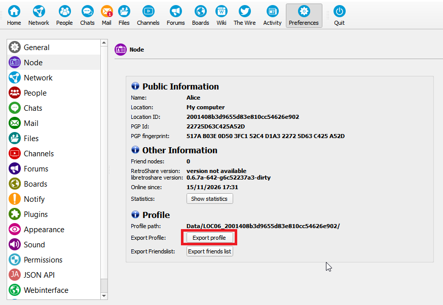
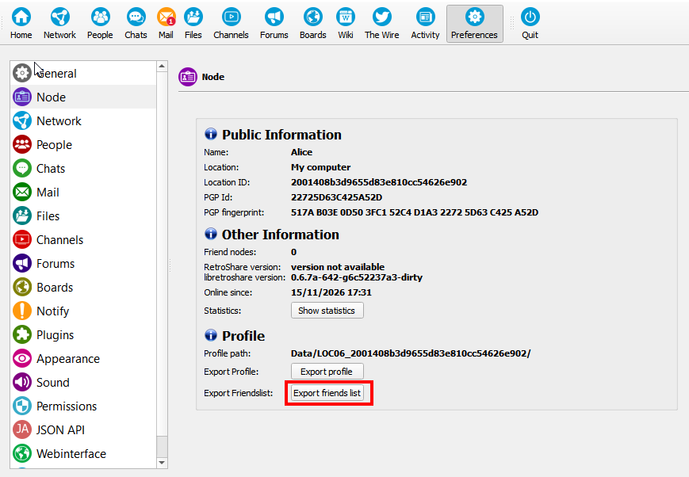
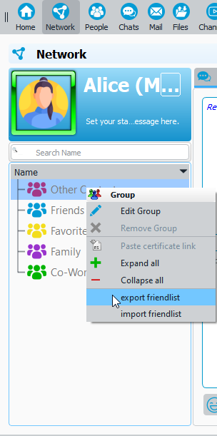
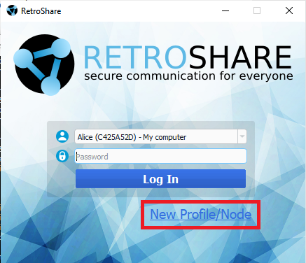
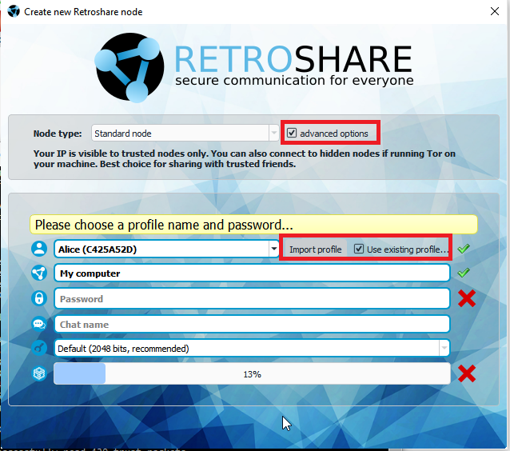
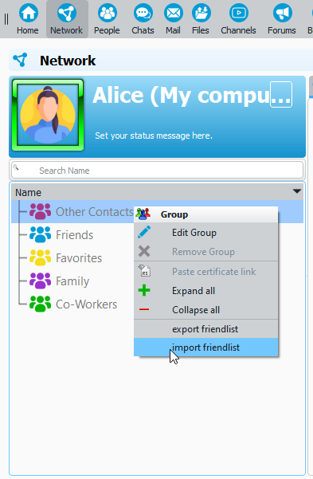
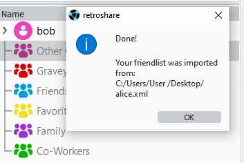

#Backup and Restore
##How to back up RetroShare and restore it on a new installation

There are two ways to save your RetroShare data. Pick the one that fits
what you want to do:

| | Full backup (data folder) | Profile + friend list export |
|---|---|---|
| What is saved | Everything: profile key, node, friends, messages, chat history, forums/channels, settings | Only your profile key (`.asc`) and your friend list (`.xml`) |
| Use it when | Moving to a new PC, reinstalling the OS, regular safety copy | Creating a second node for the same profile, starting fresh with your contacts |
| Result | Exactly the same node as before | A new node of the same profile, friends imported |

> **Warning:** The `.asc` file and the data folder contain your **private key**.
> Anyone who gets them (and your password) can act as you. Store backups
> in a safe place, for example an encrypted USB stick.

---

##1. Find your RetroShare data folder

All profiles, nodes, keys and settings are stored in one folder. Where it
is depends on your operating system and on whether you use the
**installed** or the **portable** version.

| System | Data folder |
|---|---|
| Windows (installed version) | `C:\Users\<Username>\AppData\Roaming\RetroShare\` (type `%APPDATA%\RetroShare` in the Explorer address bar) |
| Windows (portable version) | `<folder where you unpacked RetroShare>\Data\` |
| Linux | `~/.retroshare/` (hidden folder in your home directory) |
| macOS | `~/.retroshare/` (hidden folder in your home directory) |

**Tip:** RetroShare shows you where your node is stored. Open
**Preferences** → **Node** and look at **Profile path** in the
**Profile** section (see the screenshot in section 3). A path starting with
`Data/` means you are using the portable version.

**Installed or portable?** The portable version is the `.7z`/`.zip`
package you unpack yourself. It has a small file called `portable` next
to `RetroShare.exe`; as long as that file is there, RetroShare keeps all
its data in the `Data` folder beside the program instead of in
`%APPDATA%`. The installed version comes from the `Setup.exe` installer
and keeps its data in `%APPDATA%\RetroShare`.

<!-- TODO screenshot: Explorer window of a portable folder showing RetroShare.exe, the "portable" file and the "Data" folder
 -->

<!-- TODO screenshot: Explorer window at %APPDATA%\RetroShare
 -->

Hidden folders: on Linux press `Ctrl+H` in the file manager. On macOS
press `Cmd+Shift+.` in Finder to show hidden folders.

###What is inside

    RetroShare/                       (or Data/ for portable, .retroshare/ on Linux/macOS)
    ├── pgp/                          your profile key (secret keyring) and your friends' public keys
    ├── LOC06_xxxxxxxxxxxxxxxxxxxx/   one folder per node (location), named after its node ID
    │   ├── keys/                     the node's SSL certificate and private key
    │   ├── gxs/                      identities, forums, channels, boards
    │   ├── *.cfg                     friends, messages, chat, transfers, settings (encrypted)
    │   ├── Downloads/                finished downloads (default location)
    │   └── Partials/                 unfinished downloads
    └── default_cert_06.txt           remembers which node is started by default

The important parts are **`pgp`** and the **`LOC06_...`** folder(s). Without
them your profile and node are lost.

---

##2. Full backup of the data folder

This is the safest way to keep *everything*.

1. **Close RetroShare completely** (right-click the tray icon → Quit).
   Copying while it runs can give a broken backup.
2. Open your data folder (see the table above).
3. Copy the **whole folder** (`RetroShare`, `Data` or `.retroshare`) to
   your backup drive.

That's all. If space is a problem you can leave out `Downloads`
and `Partials` inside the `LOC06_...` folder (move your finished downloads
somewhere else first), but keep `pgp`, the `LOC06_...` folder(s) and
`default_cert_06.txt`.

Do this regularly, for example every few months, and before every
operating system reinstall.

###Restore the full backup on a new installation

1. Install (or unpack) RetroShare on the new computer, but **do not start
   it yet**. If you already started it, quit it again.
2. Put the backed up folder in the right place:
    - **Installed → installed:** copy it to `%APPDATA%\RetroShare`
      (Linux/macOS: `~/.retroshare`). If a folder already exists there,
      rename it first (for example `RetroShare_old`).
    - **Portable → portable:** unpack the new portable version, then copy
      the *contents* of your backed up `Data` folder into its `Data`
      folder.
    - **Portable → installed:** copy the *contents* of your old `Data`
      folder into `%APPDATA%\RetroShare`.
    - **Installed → portable:** copy the *contents* of
      `%APPDATA%\RetroShare` into the `Data` folder of the portable version.
3. Start RetroShare. Your profile and node appear in the login window.
   Log in with your usual password.

> **Note:** Do not run the same node on two computers at the same time. If you want
> RetroShare on a second computer *in addition* to the first, create a new
> node instead (section 3 below, or the
> [Second Location Creation](location.md) tutorial).

###Updating the portable version

1. Rename your current folder, for example `RetroShare_portable` →
   `RetroShare_portable_old`.
2. Unpack the new portable version to `RetroShare_portable`.
3. Copy the contents of `RetroShare_portable_old\Data` into
   `RetroShare_portable\Data`.
4. Start the new version and check that everything works, then delete the
   old folder.

---

##3. Export profile and friend list

This saves only your profile key and your contacts. Messages, chat history,
forum/channel subscriptions and settings are **not** included.

###Export your profile (.asc file)

Open **Preferences** → **Node**. In the **Profile** section click
**Export profile**.

Save the file with the ending `.asc`. It contains your profile's
private key, so keep it safe.

(On older versions: **Node** → **Certificate** → **Create new node...**,
then **Export selected profile**.)

###Export your friend list (.xml file)

On the same page, click **Export friends list** and save the `.xml` file.

You can also do this from the **Network** tab: right-click in the friend
list and choose **export friendlist**.

Copy both files (`.asc` and `.xml`) to your backup drive or to the new
computer.

###Import on a new installation

1. Start the new RetroShare. The **Create new Retroshare node** window
   opens. (If a profile already exists, click
   **New Profile/Node...** in the login window to get there.)

    

2. Tick **advanced options**. The **Import profile** button and the
   **Use existing profile...** checkbox appear next to the profile field.
3. Click **Import profile** and select your `.asc` file. Your profile is
   now chosen in the profile list and **Use existing profile...** is ticked.

    

4. Give the node a name (for example `My computer` or `laptop`) and
   enter the **password of your profile**. Move the mouse until the
   progress bar is full, then create the node.

5. Log in. The friend list is still empty.
6. Go to the **Network** tab, right-click in the friend list and choose
   **import friendlist**. Select your `.xml` file.

    

    

Your friends will see the new node under your name and connect to it
automatically once they are online. They do not need to add you again.

The steps are the same for the installed and the portable version; only
the place where RetroShare stores the new node is different (see
section 1).
