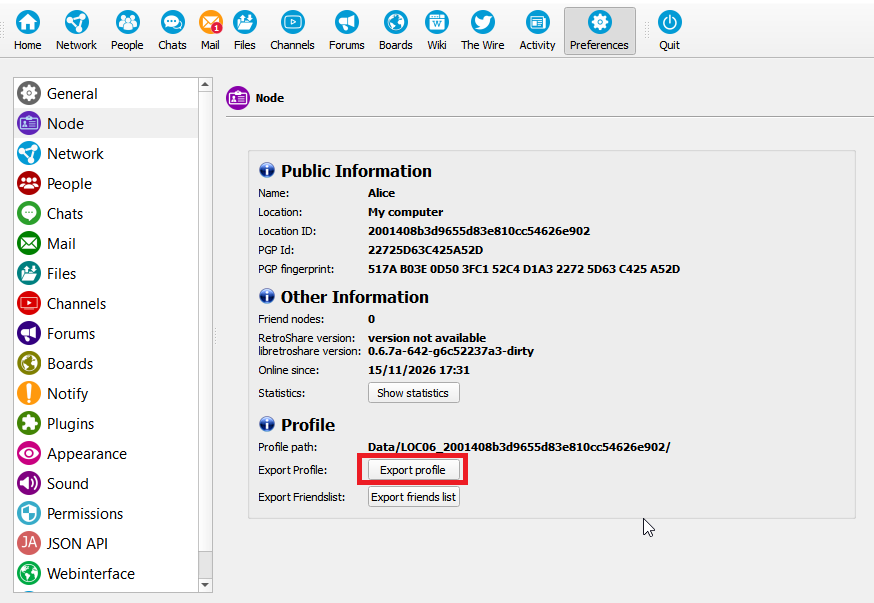
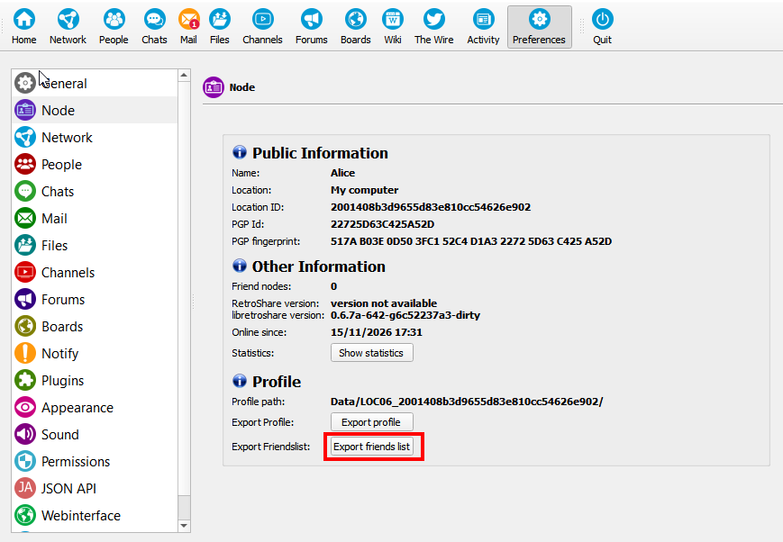
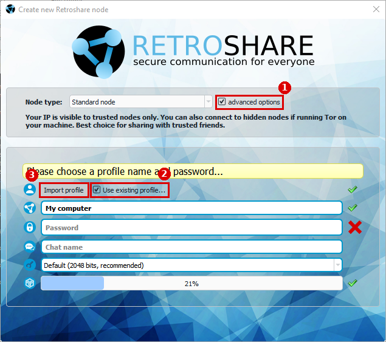
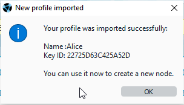
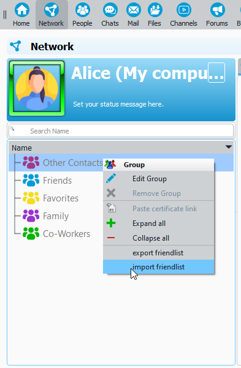
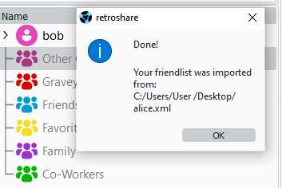
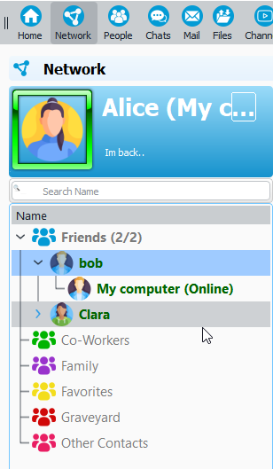

#Create new Location
##How to create a second location for an existing user account

If you want to use your RetroShare User account accross different 
Devices, for example on your PC, Laptop, NAS, Raspberry Pi , …  
its not necessary to create different Accounts for each device. 
It’s possible to create with the same user different locations, 
which are recognized by your friends as owned by your User automatically. 
This avoids the additional Key Exchange with all your friends when you 
use RetroShare on a new device. Each location can connect to friends 
where your User account is already in the friended.

Creating a new location with the same user is easy, if you know how.  

##A small example with Alice, Bob and Clara

Alice has RetroShare on her PC and is friends with Bob and Clara. Now she
buys a laptop and wants to use RetroShare there too. On the laptop she
creates a new node for her existing profile and imports her friend list
from the PC.

Bob and Clara don't need to do anything. Alice's new node simply appears
under Alice in their friend list.

Here is how Alice does it, step by step.  

 

###Step 1: Export your profile on the first node

On your first node open **Preferences** → **Node**. In the **Profile**
section click **Export profile**.

Save it with the file ending `.asc`.

This file contains the private PGP key of your RetroShare profile. With it
you can create new nodes for the same profile. Keep it safe and don't
share it with anyone.

###Step 2: Export your friend list on the first node

On the same page click **Export friends list** and save the `.xml` file.

(You can also do this in the **Network** tab: right-click in the friend
list and choose **export friendlist**.)

Copy both files (`.asc` and `.xml`) to the second computer, for example
with a USB stick.

###Step 3: Create the new node on the second computer

Start RetroShare on the second computer. The **Create new Retroshare node**
window opens. (If RetroShare already has a profile, click
**New Profile / Node...** in the login window to get there.)

1. Tick **advanced options**.
2. Tick **Use existing profile...**.
3. Click **Import profile** and select your `.asc` file.

RetroShare confirms that the profile was imported:

Click **OK**. Your profile is now selected. Then:

- enter a name for the new node (location), for example `Laptop`,
- enter the **password of your profile** (the same password as on your
  first node),
- move the mouse until the progress bar is full,
- create the node.

Now your new node works, but its friend list is still empty.

###Step 4: Import your friend list on the new node

Log in, go to the **Network** tab, right-click in the friend list and
choose **import friendlist**. Select the `.xml` file from your first node.

Your friends from your first location are now available on your second 
location. Your first node and your second node are also friended.

  

from <a href="https://blog.cavebeat.org/2015/09/how-to-create-a-second-location-for-an-existing-user-account/">blog.cavebeat.org</a> <a href="http://creativecommons.org/licenses/by-sa/4.0/">CC BY-SA 4.0</a>
